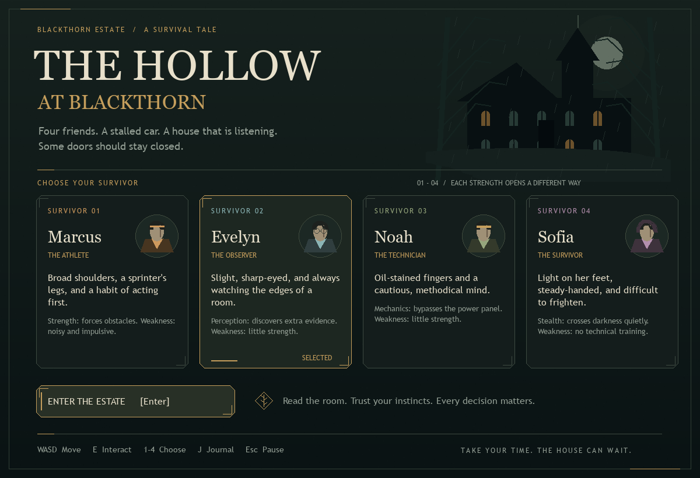

# The Hollow at Blackthorn

A small playable 2D Pygame prototype for CIS350, based on the supplied
[horror game design conversation](https://chatgpt.com/share/6ad5297a-3800-83ea-8243-b42b61dc44c2).

Choose one of four survivors, explore five scenes, collect evidence, and escape
the masked killer—or turn the house's trap against him. A run takes about 5–10
minutes. Everything is drawn with Pygame shapes; no asset downloads are needed.



The interface uses an estate-dossier style: serif headings, brass borders,
ink-green panels, survivor portraits, a paper journal, and procedural manor art.
All art is generated locally by Pygame. Fonts fall back to available system fonts
or Pygame's bundled font, so no extra assets or dependencies are required.

## Run

Use **Python 3.10-3.13** (3.13 recommended) on Windows, macOS, or desktop Linux.
The pinned Pygame 2.6.1 release has prebuilt packages for these Python versions
on common Windows, macOS (Intel/Apple Silicon), and Linux systems. Newer Python
versions may need a different Pygame release or a source build; they are not the
target for this prototype. See the [Pygame release files](https://pypi.org/project/pygame/2.6.1/#files).

Clone the repository or download its source, open a terminal in the project
folder, then follow the instructions for your operating system.

### Windows (PowerShell)

```powershell
python -m venv .venv
.\.venv\Scripts\python.exe -m pip install -r requirements.txt
.\.venv\Scripts\python.exe main.py
```

After setup, you can also double-click **Play.bat**. If Python is missing, install
Python 3.13 from [python.org](https://www.python.org/downloads/) and enable its PATH
option during installation. If your installation uses the `py` launcher, use
`py -3.13 -m venv .venv` for the first command.

### macOS / Linux

Install Python 3.10-3.13 first. From the project folder:

```bash
python3 -m venv .venv
.venv/bin/python -m pip install -r requirements.txt
.venv/bin/python main.py
```

After setup, `sh play.sh` also starts the game. This works without changing file
permissions. On macOS, use your installed Python 3 interpreter, rather than a
system Python 2 installation. If several versions are installed, use `python3.13`
in place of `python3` when creating the environment.

On Ubuntu/Debian, missing Python environment tools can be installed with:

```bash
sudo apt update
sudo apt install python3 python3-venv python3-pip
```

Check `python3 --version`: if your distribution supplies a version outside the
supported range, install Python 3.13 before creating the environment.

### WSL

Use the Linux instructions in a WSL installation with GUI support (WSLg or a
configured display server). A desktop display is needed for the playable window.
The tests below can run without one.

Create a separate Linux environment if you share a project folder with Windows:

```bash
python3 -m venv .venv-linux
.venv-linux/bin/python -m pip install -r requirements.txt
.venv-linux/bin/python main.py
```

The Unix launcher recognizes `.venv-linux` too. Virtual environments are local
to each machine/OS; never copy or commit them. No game assets need downloading.

## Controls

| Input | Action |
| --- | --- |
| 1–4 on the title screen / click a character | Select survivor |
| Enter / click Enter the Estate | Start |
| WASD / arrow keys | Walk around the 2D scene |
| E near a numbered marker | Interact |
| 1–4 / click an action | Choose an action from anywhere in the room |
| Enter / Space / click Continue | Dismiss an outcome |
| J | Open/close clue journal |
| Esc / P | Pause/resume; Esc also closes the journal |
| Enter / R after an ending | Return to character selection |
| Window close button | Quit |

Every attempted action costs a decision, including failed attempts. Walking,
reading the scene, and checking the journal cost nothing. Leaving a scene ends
your time there. When decisions run out, footsteps force you onward and threat
increases. At six threat, the killer finds you. There is no real-time countdown.
An outcome stays on screen until you dismiss it; it will never skip unread text.

Marcus can force obstacles; Evelyn discovers a hidden clue; Noah can bypass the
gate relay without its diagram; Sofia can move safely through darkness. Everyone
has a route to escape and a route to use the trap. Inventory and clues last for
the current run. Repeated searches are disabled.

## Prototype scope

Includes character selection, a movable top-down character, furniture collision,
rain and darkness, limited scene decisions, inventory, clue journal, a threat
meter, character-dependent outcomes, four survival endings and fatal branches.
It deliberately uses decision-based danger rather than a pursuing enemy AI.
There is no save system, audio, combat system, or full campaign.

## Checks

```powershell
python -m unittest -v
python main.py --smoke-test --screenshot preview.png
```

The first command checks story branches and state transitions. The second uses
SDL's dummy display to exercise every scene, menu, overlay, and ending renderer.

`story.py` holds the characters, scenes, and rules; `main.py` handles Pygame
rendering and input. [DESIGN.md](DESIGN.md) explains the data model, decision flow,
UI coordinates, design choices, limitations, and how to extend the prototype.

## Development setup

For an isolated environment, run these commands from the project folder. Using
the environment's Python directly avoids needing to activate it in PowerShell:

```powershell
python -m venv .venv
.\.venv\Scripts\python.exe -m pip install -r requirements-dev.txt
.\.venv\Scripts\python.exe main.py
```

The Windows launcher prefers `.venv` when it exists, otherwise it uses `python`.
Pygame is the only runtime dependency. Ruff is an optional development tool.

For macOS/Linux development, create `.venv` as above, then run:

```bash
.venv/bin/python -m pip install -r requirements-dev.txt
.venv/bin/python -m ruff check .
.venv/bin/python -m ruff format --check .
.venv/bin/python -m unittest -v
.venv/bin/python main.py --smoke-test
```

After installing development dependencies:

```powershell
.\.venv\Scripts\ruff.exe check .
.\.venv\Scripts\ruff.exe format --check .
.\.venv\Scripts\python.exe -m unittest -v
.\.venv\Scripts\python.exe main.py --smoke-test --screenshot preview.png
```

Use `ruff format .` to apply formatting. The shared configuration targets Python
3.10 and uses a 100-character formatting width. Tests cover both story rules and
headless UI input; manual playtesting is still useful for layout and story flow.

## Uploading with Git

See [GIT_SETUP.md](GIT_SETUP.md) for first-upload and collaborator instructions.
The repository should contain source, documentation, launchers, requirements,
configuration, tests, and the preview. Local tools, environments, caches,
executables, and ZIP archives are ignored. Upload source directly with Git;
the previously flagged ZIP is not needed.

The included GitHub Actions workflow runs checks on Windows, macOS, and Linux
with Python 3.10 and 3.13 after a push or pull request. These are configured tests,
not a claim that all platforms have already passed: inspect the repository's
Actions tab after uploading. The current local checks were run on Windows.

## Optional walkthrough (spoilers)

For an evidence escape with any character: take the flashlight, inspect the
tracks, enter the estate; read the note, inspect the chandelier; search the
pantry, read the scratches, take the service stairs; read the maintenance log,
bypass the override, take the passage; open the gate.

For the trap ending, follow the same path and cut the service rope in the yard.
Marcus can also escape directly through the dining-room window.
